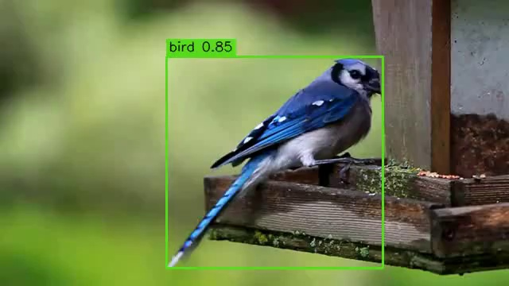

# Детектор птахів — YOLO26n

Один клас `bird`. Скрипт обробляє кожен кадр відео, додає рамки, назву й впевненість та зберігає MP4.



[Вхідне відео](examples/input.mp4) · [Результат](examples/output.mp4) · [Порівняння всіх етапів](reports/improvement.md)

## Встановлення

Перевірено на macOS 15.8.1, Intel i7/Radeon 555X, 32 ГБ, Python 3.11.6. Версії залежностей зафіксовані.

```bash
git clone https://github.com/tarasenkoandriii/bird-detector.git
cd bird-detector
python3.11 -m venv .venv
source .venv/bin/activate
python -m pip install -r requirements.txt
python -m pip check
```

Для H.264 рекомендовано FFmpeg: `brew install ffmpeg`. Без нього відео зберігається як `mp4v`, сумісність із браузером залежить від браузера.

## Обробка відео

Датасет завантажувати не потрібно.

```bash
python predict_video.py --input examples/input.mp4 --output examples/output.mp4 --overwrite
```

Типові параметри: `--weights weights/best.pt --imgsz 640 --conf 0.25 --iou 0.5 --device auto`. Пристрій можна задати явно: `cpu`, `mps` або індекс CUDA. Новий вихідний файл не потребує `--overwrite`.

Зберігаються всі кадри, розмір і FPS; аудіо не копіюється. Вихід перевіряється повторним декодуванням. Поруч створюється `*.metrics.json` із часом, кількістю кадрів і хешем ваг.

## Датасет

[CUB-200-2011](https://www.vision.caltech.edu/datasets/cub_200_2011/): 200 видів об’єднані в один клас. Фінальний набір: **5 377 train / 600 validation / 499 test**. Вихідні bbox перетворені на нормалізований YOLO-формат; розмітку, дублікати й перетини вибірок перевірено. Перцептивний пошук схожих кадрів евристичний.

Дані завантажуються окремо, без ключів. Лише некомерційні дослідження та навчання; джерела й ліцензії — [THIRD_PARTY.md](THIRD_PARTY.md).

## Навчання

Команди для чистої копії проєкту:

```bash
# Початкова підвибірка: 998/200/100.
python prepare_data.py
python train.py
python train_boxes.py --model runs/train/bird/weights/best.pt --name bbox-conservative

# Розширення зі збереженням захисту попередніх вибірок.
python prepare_expanded.py
python train_boxes.py --data datasets/bird-expanded/data.yaml \
  --model runs/experiments/bbox-conservative/weights/best.pt \
  --imgsz 640 --epochs 3 --lr0 0.00001 --name expanded-bbox640
```

Етапи: 5 епох класифікації → 3 bbox-епохи при 320 → 3 bbox-епохи при 640. AdamW, batch=8, CPU; backbone і neck зафіксовані. Останній етап зайняв близько **48 хв**. Параметри — [training_provenance.json](reports/training_provenance.json).

Результат: `runs/experiments/expanded-bbox640/weights/best.pt`. Обробка відео власними навченими вагами:

```bash
python predict_video.py --input examples/input.mp4 --output examples/my_output.mp4 \
  --weights runs/experiments/expanded-bbox640/weights/best.pt
```

Додані `weights/best.pt` не перезаписуються. Для повторного навчання задайте нове `--name`; уже підготовлені каталоги даних пропустіть. Повторний запуск може дати дещо інші числа.

## Метрики на валідації та тесті

CPU, 640 px, batch=4; кандидат обрано за validation, test оцінено після вибору.

| Метрика | Валідація, 600 | Тест, 499 |
|---|---:|---:|
| Precision | 95,28% | 98,21% |
| Recall | 95,17% | 96,59% |
| mAP50 | 98,06% | 99,16% |
| mAP50–95 | **81,08%** | **83,62%** |

Останній етап додав **+0,84 в.п. validation** і **+0,73 в.п. test mAP50–95** на тих самих вибірках. Усі етапи й експерименти — [improvement.md](reports/improvement.md).

```bash
python evaluate.py --data datasets/bird-expanded/data.yaml --split val --imgsz 640
python evaluate.py --data datasets/bird-expanded/data.yaml --split test --imgsz 640
python -m unittest discover -s tests -v
```

**19 тестів пройшли.** Відеоприклад: 240/240 кадрів, приблизно 10 кадрів/с на MPS. Це швидкість обробки, не FPS відтворення чи оцінка recall.

## Відеоперевірка

Окремий LaSOT-тест: **59,33% цільового recall при IoU≥0,5 на 300 кадрах**. Розмітка охоплює одного птаха на кадр, тому це не повний mAP відеодетектора. [Метрики й команди](reports/video_test.md).

## Проблеми та можливі покращення

- Перенесення з фотографій CUB на відео слабше: наступний крок — донавчання на розмічених польотах, дрібних птахах і негативних сценах із розділенням за роликами.
- Старий MPS спотворював відновлення координат: `SafeDetectionPredictor` виконує цей крок на CPU, залишаючи нейромережу на вибраному пристрої.
- Відео має додатковий NMS IoU=0.5; офіційні метрики валідатора його не включають. Покадрової еталонної розмітки прикладу немає.

[Підготовка й запуск у Warp](reports/expanded_dataset.md) · [Наступні експерименти](reports/finetuning_recommendations.md) · [Перевірки](reports/verification.md)

Код — AGPL-3.0. Умови датасету й відео наведені окремо в THIRD_PARTY.md.

## Файли для здачі

[Код і README](https://github.com/tarasenkoandriii/bird-detector) · [Навчені ваги](weights/best.pt) · [Вхідне відео](examples/input.mp4) · [Оброблене відео](examples/output.mp4).

```text
bird-detector/
├── README.md
├── requirements.txt
├── train.py
├── predict_video.py
├── weights/best.pt
└── examples/
    ├── input.mp4
    └── output.mp4
```

Додаткові скрипти підготовки, навчання й оцінювання забезпечують відтворення описаних результатів.
