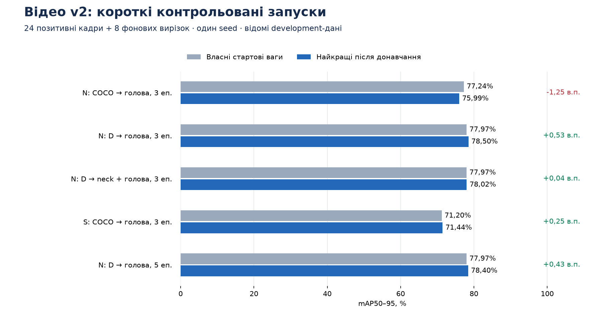

# Короткі експерименти з відеоадаптації

Мета — вибрати перспективний напрям за короткими контрольованими запусками, зберігши обов’язкову для ТЗ YOLO26n. YOLO26s перевіряється окремим кандидатом. Історичні A–D та їхнє правило порівняння не змінюються.

## Дані та умови

Окрема **v2 development-validation**: 24 позитивні кадри з двох відеопослідовностей і 8 фонових вирізок. Рамки охоплюють усі видимі частини птаха. Розмітку асистента створено без прогнозів моделей; незалежного людського аудиту немає. Це ті самі відомі validation-зображення, а не новий незалежний test.

Початкова LaSOT-розмітка була призначена для tracking і часто не включала видимі ноги. Числове перетворення на YOLO було правильним. Legacy-розмітку та її оцінки збережено. **Різниця між legacy і v2 — зміна еталонної розмітки, а не покращення ваг.** Метрики цих двох протоколів не порівнюються між собою.

Навчання: 102 унікальні відеоприклади із семи послідовностей; 15 додаткових кадрів повторено тричі; додано 32 фото CUB. Разом **164 пред’явлення за епоху**. Train і validation розділені за відеопослідовностями; аудит точних та евристичних перетинів пройшов.

Усі 3-епохові запуски: CPU, 640 px, batch=nbs=8, AdamW, LR=3e-6, seed=data-seed=26, без геометричних/колірних аугментацій; backbone і статистики BN зафіксовано. Відрізняються стартові ваги та дозволені до навчання шари. Важкі обчислення виконувалися послідовно; агенти паралельно готували й перевіряли рецепти.

Кожен trained-кандидат порівнюється зі **своїми вагами до донавчання**. «Вихідна модель» тут означає pretrained COCO YOLO26, а не випадкову ініціалізацію. Для raw N/S перевірено еквівалентність перенесення bird=14 → bird=0; live/EMA до першого кроку, заморожені параметри та BN захищено перевірками.

## Результати навчання

Стандартний валідатор: CPU, 640 px, batch=4, conf=0,001, IoU=0,7, max_det=300. mAP50–95 наведено у відсотках, приріст — у відсоткових пунктах.

| Старт → навчання | Епох | Старт | Найкращі trained-ваги | Приріст до власного старту |
|---|---:|---:|---:|---:|
| Pretrained N → head | 3 | 77,24% | 75,99% | −1,25 в.п. |
| D → head | 3 | 77,97% | **78,50%** | **+0,53 в.п.** |
| D → neck + head | 3 | 77,97% | 78,02% | +0,04 в.п. |
| Pretrained S → head | 3 | 71,20% | 71,44% | +0,25 в.п. |
| D → head, свіжий запуск | 5 | 77,97% | 78,40% | +0,43 в.п. |



Найперспективніший виміряний напрям — **дані + head від D, 3 епохи**. Найкращий checkpoint отримано після другої епохи. П’яти­епоховий рецепт мав найкращий checkpoint після першої епохи та не перевершив коротший. Neck не дав додаткової переваги в цій серії.

S поліпшила власний старт, але залишилася нижче nano. Це результат конкретного head-only рецепта й одного seed; повне донавчання S не досліджувалося. Називати її кращим учителем для дистиляції за цим контролем підстав немає.

Для raw N після навчання стало гірше, тому engine залишив початкові ваги кандидатом. Позначка `selected` у статусі означає лише проходження власного video-epoch0-критерію; вона не є рішенням про реліз.

## Контроль якості на фото

На тих самих 600 CUB validation-зображеннях (CPU, 640 px, batch=4): D — **81,1704%**, head3 — **81,0810%**, head5 — **81,0932%** mAP50–95. У head3 відеоприріст +0,5271 в.п. супроводжується зниженням фотооцінки на 0,0894 в.п. Це виміряний компроміс. Хеші ваг і всіх 600 зображень/розміток перевірені до та після оцінювання. [Повний контроль](photo_guard.json).

Ваги head3 збережено як експериментальні [`weights/video_focus.pt`](../../weights/video_focus.pt). Релізний D залишається `weights/best.pt`.

[Відеоприклад head3](../../examples/output_video_focus.mp4): 240/240 кадрів, без пропусків, 9,28 кадру/с на CPU. Еталонної покадрової розмітки цього прикладу немає, тому він демонструє роботу скрипта, а не вимірює AP чи recall. [Параметри та перевірка декодування](../../examples/output_video_focus.metrics.json).

За conf=0,25 і додаткового NMS IoU=0,5 у D, head3 і head5 — **0/8 фонових вирізок із хибними детекціями**. Вісім негативних зображень/розміток v2 байт-в-байт збігаються з legacy; перевірено саме їх. Це не оцінка на повних негативних роликах. [D](backgrounds_D0.json) · [head3](backgrounds_head3.json) · [head5](backgrounds_head5.json).

## Комбінація з tiled inference

Зафіксовано head3, tile=640 px, overlap=20%, повний кадр + tiles, однаковий global NMS IoU=0,7 для двох режимів. Власна реалізація за принципом SAHI; пакет `sahi` не використовувався. Параметри за результатом не підбиралися.

| Власний парний протокол F | Повний кадр | Повний кадр + tiles |
|---|---:|---:|
| mAP50–95 | **74,99%** | 41,59% |
| mAP50 | **98,64%** | 64,12% |
| Обробка, кадрів/с | **10,79** | 1,37 |
| Forward-виклики на 32 зображення | **32** | 176 |
| Фонові приклади з FP / 8, conf≥0,25 | 0 | 0 |

**E3 + F відхилено:** −33,40 в.п. mAP50–95 та приблизно у 7,88 раза довший час. Тут переважають великі цілі; результат не перевіряє перевагу SAHI на спеціальній вибірці дрібних птахів. Час включає читання, декодування, інференс і NMS; після одного прогріву, без обчислення AP.

F використовує `predict(batch=1, rect=True)` й додатковий NMS. Його 74,99% **не порівнюються безпосередньо** зі стандартними 78,50% вище. Висновок F зроблено лише з різниці між двома його режимами. [Повні результати, координати, хеші та час](tiled_d_head3/results.json).

```bash
python evaluate_tiled.py --weights weights/video_focus.pt \
  --out reports/my-tiled-control
```

## Рішення

Продовжувати напрям **повністю розмічені різноманітні відеодані + консервативне донавчання голови nano**. Поточний кандидат дає невеликий відеоприріст із невеликим фото-компромісом. Перед заміною основного D потрібні повтори на кількох seed і нові незалежні відеопослідовності. Довільно збільшувати епохи, підключати цей tiling чи брати S як учителя за поточними вимірами підстав немає.

## Відтворення

Підготовка даних у чистій копії проєкту; уже наявні набори пропустіть:

```bash
source .venv/bin/activate
python prepare_data.py
python prepare_expanded.py
python prepare_video_training.py
python prepare_video_focus_data.py
python prepare_video_detection_v2.py

# Послідовно, з новими іменами запусків.
python train_video_neck.py --base weights/best.pt --scope head \
  --epochs 3 --name my-d-head3
python train_video_neck.py --base weights/best.pt --scope neck-head \
  --epochs 3 --name my-d-neck3
python train_video_neck.py --base yolo26n.pt --scope head \
  --epochs 3 --name my-raw-n-head3
python train_video_small.py --base yolo26s.pt \
  --epochs 3 --name my-small-head3
python train_video_neck.py --base weights/best.pt --scope head \
  --epochs 5 --name my-d-head5

# Готовий експериментальний nano-кандидат.
python predict_video.py --weights weights/video_focus.pt \
  --input examples/input.mp4 --output examples/my_video_focus.mp4 --device cpu
```

`yolo26n.pt` і `yolo26s.pt` — офіційні pretrained-ваги Ultralytics, які потрібно отримати окремо. Скрипти не змінюють релізні ваги. Датасети та наявні імена запусків не перезаписуються. П’яти­епоховий запуск починається заново з D: він має інший горизонт scheduler і співвідношення one-to-many/one-to-one loss, тому це окремий рецепт, а не продовження 3 епох ще на 2.

## Межі висновків

Коротка серія з одним seed дає напрям для наступної перевірки. Вона не доводить статистичної переваги на довільних відео. Для широкого висновку потрібні нові незалежні послідовності, дрібні птахи, польоти, складний фон та більше негативних сцен. Тестові вибірки в цій серії не використовувалися.

Дистиляцію та P2-архітектуру тут не запускали. S має спершу довести перевагу як учитель; стандартна feature-дистиляція із замороженим neck не адаптує ознаки студента. Обов’язковий nano-вихід для ТЗ зберігається.

[Фіксований план](plan.json) · [Початкові оцінки](baselines.json) · [Точні результати](comparison.json) · [CSV](comparison.csv)
